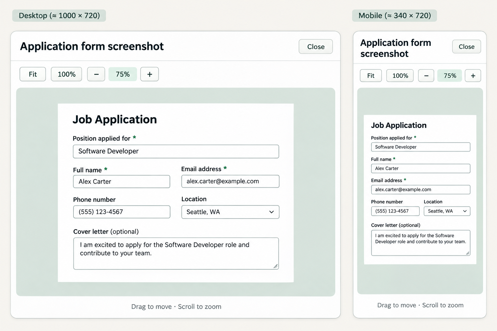

# Shared image inspection

Implemented and checked 2026-11-10. Captured forms, saved screenshots and document
page images share one viewer using the existing colors, secondary buttons and
focus styling. This closes the narrow-screen capture-magnification gap in
[the rendered history workflow](../../RENDERED_HISTORY_WORKFLOW.md).

## Interaction contract

- A local raster preview exposes a zoom cursor and opens on mouse click.
  Images inside links/buttons/dialogs retain their original behavior.
- **Fit**, **100%**, minus and plus share one zoom model. Wheel zoom stays anchored
  to the pointer; dragging pans. Position/scale limits keep the image bounded.
  The native corner grip resizes both dialog axes within viewport-dependent limits.
- Resizing preserves the inspected point in manual mode and refits in Fit mode.
  Ctrl/Meta wheel retains browser zoom. Touch pointer dragging uses the same
  state; touch-device hardware was not qualified.
- Source pixels, proportions and inline styles remain unchanged. Transforms
  affect a separate displayed image. No archived capture, answer, approval or
  review result is modified. Screenshot contents do not reflow at narrow widths.
- Keyboard activation, native Escape and focus restoration complement mouse
  controls. Closing releases the displayed source immediately. Generation checks
  and idempotent cleanup prevent late decoding/close events reviving or clearing
  another preview.
- Only bounded PNG/JPEG/WebP data sources qualify. Remote/SVG/HTML sources are
  excluded and decoded dimensions are capped. Loading/error states disable zoom.
  Changed ineligible sources restore original element attributes. One observer
  and controller serve the page, using weak element references.

## Design and refinement

This is a built-in image-generation reference, not a product screenshot. The
working viewer uses its heading/toolbar/canvas/footer hierarchy and established
tokens. Form contents are fictional illustration; actual screenshots preserve
their original pixels. Four compiled headless rounds and direct visual inspection
followed generation. The first round exposed deferred image cleanup after closing;
synchronous, idempotent cleanup fixed it. A later short-window check exposed a collapsed canvas; a minimum image area with scrollable overflow fixed that case. Failed evidence remains retained.

Final generation prompt, opaque background, built-in mode:

> Create a precise flat product UI design reference board, not a photo, for the existing Windows local web app Smart Jobseeker. Two views on one board: a large desktop image inspection dialog and its narrow mobile counterpart. Follow this existing visual system faithfully: warm off-white #f8f7f3 surrounding app; white #ffffff cards; dark ink #182a2b; muted #526565; forest green #165d52; pale green #e8f2ed; fine border #dce3dd; clean Segoe UI-like typography; gentle 10px corners; restrained, professional, calm. The dialog reviews a screenshot or PDF page. Desktop title 'Application form screenshot' at top left with a small 'Close' button top right. A separate compact toolbar row with secondary buttons 'Fit', '100%', '−', a readout '75%', and '+'. Main canvas is a quiet light gray-green, containing a white fictional application screenshot with a few crisp labels and input outlines, centred and correctly proportioned. Bottom fine caption 'Drag to move · Scroll to zoom'. Desktop dialog about 1000x720. Narrow mobile view about 340x720: exact same control vocabulary, title wraps cleanly, Close remains accessible, toolbar fits one row, image canvas takes remaining height. No navigation sidebar, marketing, gradients, decorations, mascots, logos, branding slogans, oversized typography or unnecessary cards. Clearly mark desktop and mobile outside the dialogs. This is a layout/spacing reference; make all control text crisp and consistent.

## Measured scope

The compiled interface passed 21 headless checks with Chromium 157.0.8103.39:
fit/aspect ratio, actual size, mouse panning, anchored wheel zoom, native corner
resizing, five widths from 320–1920 pixels, six actual browser zoom levels from
80–400%, unchanged source bytes/styles, keyboard/focus, close-during-decode and
changed-source behavior. Two short-window heights (640/480 pixels at 400% browser zoom) also retained a usable image area and reachable controls through scrolling. Desktop, 390-pixel and native 400% captures were inspected.
An owned fictional screenshot was injected into the production interface; no API
responses were substituted or employer forms used. This does not qualify every
product image flow, browser or assistive technology.

Private receipt: `target/image-viewer-ui-Un7q7A/result.private.json`, SHA-256
`40dd37268f9fc6f29c0ddc84a94abd4fa7b6dbdf5aa2114b5a208ad35ba1e8d1`.
Executable SHA-256:
`dc9b76e30c434a32f9a17e80972c07a36d54b4c41d4d96965eda64dd403e6979`.
The process tree was capped at four GiB; its 5.582-second command is not a peak
resource benchmark. Image-boundary/geometry tests and the full 164-script
JavaScript suite passed. The viewer requires no model or external image request.
